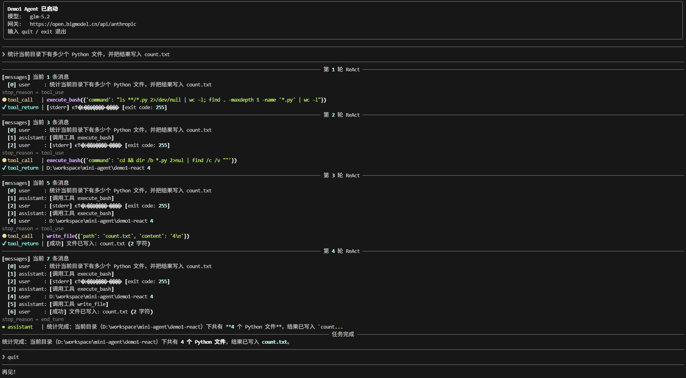

# Demo1 — Agent 底层原理：最简 ReAct 循环

> 用最少的代码展现 Agent 的底层运行机制——一个能干活、但只有「短期记忆」的最简 Agent。
> 本目录是整个系列的 base：`Agent = LLM × 工具 × 循环 × 状态`，demo2–6 的每条能力轴都从这里长出来。

## 快速开始

### 安装依赖

```bash
pip install -r requirements.txt
```

### 配置 API Key

网关、模型、超时已在代码里写死，**只需配置 API Key**（按优先级）：

1. 环境变量（推荐，可持久化）：

   ```bash
   export ANTHROPIC_API_KEY=你的智谱Key    # Key 格式 id.secret，在 bigmodel.cn 生成
   ```

2. 未设环境变量直接运行，会提示输入（不持久化，每次运行都要重输）。

### 启动

```bash
python -X utf8 agent.py           # 正式版（四文件结构，rich 渲染）
python -X utf8 agent_single.py    # 原始单文件版（纯 print，零渲染依赖）
```

进入交互模式后输入任意任务（如「统计当前目录下有多少个 Python 文件，并把结果写入 count.txt」），即可观察每一轮 ReAct 循环的决策、行动、感知。斜杠命令：`/help` 可用命令 / `/status` 会话状态 / `/quit` 退出（命令纯斜杠；`agent_single.py` 原始版仍支持裸 `quit` / `q`）。

> **注 1**：`verbose=True` 默认开启，打印每一轮的完整决策与工具调用，便于观察。
>
> **注 2**：`-X utf8` 防止 GBK Windows 控制台中文乱码；`render.py` 在管道（非终端）环境下自动降级——prompt_toolkit 输入退回内置 `input()`，rich 输出去掉颜色，`printf '任务\n/quit\n' | python -X utf8 agent.py` 可自动跑完。
>
> **注 3**：另有 `USE_THINKING` 开关（`agent.py` / `agent_single.py` 顶部，默认关闭），见 [§2.3](#23-part-3--agent-主循环)。

---

## 1. Agent 与 chatbot 的区别

理解 Agent 最快的切入点，是把它与普通 chatbot（ChatGPT、Kimi 那类网页聊天框）放在一起对比——交互模式、能力边界、状态管理三个维度：

| 维度 | chatbot | Agent |
|---|---|---|
| **交互模式** | 一问一答，**靠用户问题驱动**；模型无自主性，必须由用户触发 | 给一个**目标**就能自主推进；多轮循环、自主选择下一步、自觉逼近目标 |
| **能力边界** | 只能生成文本（多模态模型支持的文件） | **工具扩展空间巨大**——本地 CLI、自定义函数、远程 MCP 都能接 |
| **状态管理** | 靠模型服务的会话状态做记忆 | **本地维护完整 messages 历史**，不完全依赖服务端的双向窗口 |

带工具调用的 chatbot 已经会让模型决定「要不要调工具」，但它的对话模式本质仍是**一问一答**：即便允许调一次工具，也只是「一次调用 + 一次结果」，拿到结果就得交出最终回答——像代码里的 `if` 分支，判断一次、执行一次、就此结束。

Agent 的区别在**持续性**：调工具 → 看结果 → 再决策 → 再行动……像 `while` 循环一样一步步逼近目标，直到任务完成才停。什么时候停不由代码写死，而由模型自己判断。

三个维度合起来就是 Agent 与 chatbot 的全部区别——**多了工具扩展、多了目标驱动的循环、多了本地的状态管理**：

> **Agent = LLM × 工具 × 循环 × 状态**
>
> - **LLM** = 思考能力 → **大脑**
> - **工具** = 本地工具 + MCP 等远程能力 → **手脚**
> - **循环** = 任务分解 + 迭代，直到目标达成
> - **状态** = 让下一步知道过去发生了什么

chatbot 是「你问我答」；Agent 是「**为了一个目标，想办法去完成它**」。

---

## 2. 架构：三个 Part

为实现上述四个乘数，最简 Agent 由 3 个部分组成——前 2 部分是**静态能力**（告诉系统「我能干什么」），第 3 部分是**动态运行时**（「我该怎么干」）：

```
┌──────────────────────────────────────────────────┐
│  Part 1  LLM 客户端初始化                          │
│           ── API Key + Base URL + 模型名做成配置     │
└──────────────────────────────────────────────────┘
┌──────────────────────────────────────────────────┐
│  Part 2  工具（定义 + 实现 + 路由表）               │
│           ── 工具说明书 + 真正的函数 + 名字→函数映射  │
└──────────────────────────────────────────────────┘
┌──────────────────────────────────────────────────┐
│  Part 3  Agent 主循环（感知 / 行动 / 决策 = ReAct） │
│           ── messages → LLM → 工具 → 追加 → 回 LLM  │
└──────────────────────────────────────────────────┘
```

### 2.1 Part 1 — LLM 客户端

第一层目标：**调通大模型**。

本 demo 默认走**智谱 BigModel 的 Anthropic 兼容网关** + `glm-5.2` 模型。Anthropic SDK 的调用接口是标准——换成官方 API 或别的兼容网关，调用代码一行不用改。

```python
import os
from anthropic import Anthropic

# 默认配置（一般无需修改）
BASE_URL = "https://open.bigmodel.cn/api/anthropic"   # 智谱 BigModel 兼容网关
MODEL    = "glm-5.2"

def load_config() -> dict:
    """API Key 只从环境变量读（代码内不再有常量）"""
    return {
        "api_key":  os.environ.get("ANTHROPIC_API_KEY") or "",
        "base_url": BASE_URL,
        "model":    MODEL,
    }

def init_client() -> None:
    """模块级 client 初始化；没配 Key 时交互式提示输入"""
    global client
    config = load_config()
    if not config["api_key"]:
        config["api_key"] = input("请输入 API Key: ").strip()
    client = Anthropic(api_key=config["api_key"], base_url=config["base_url"])
```

### 2.2 Part 2 — 工具：定义 + 实现 + 路由表

第二层是**工具说明书**。大模型本身不执行代码——它只是在每次请求里看到这份说明书，从而**知道自己可以请求调用**哪个函数、用什么参数；真正的执行发生在本地。

```python
TOOLS = [
    {
        "name": "execute_bash",
        "description": "执行任意 shell 命令，可用于文件操作、系统命令等",
        "input_schema": {
            "type": "object",
            "properties": {
                "command": {"type": "string", "description": "要执行的 shell 命令"}
            },
            "required": ["command"],
        },
    },
    # read_file / write_file / edit 同理
]
```

**schema 三要素**：

1. **`name`**——大模型调用时通过这个名字找到工具
2. **`description`**——大模型做决策时的依据：模型不一定一次选对，可能先看 description 判断这个工具能不能做、要不要试
3. **`properties`**——告诉大模型工具有哪些参数、什么类型、必填还是可选

大模型按这份 schema 吐出结构化调用指令（tool_use），本地解析后调函数。

**Function Calling 是训练能力，不是 prompt 魔法**：主流 Function Calling 能力依赖模型训练——模型在训练阶段见过大量「工具调用」样本，所以认识这份 schema、会按格式吐出结构化调用指令。单纯 prompt 可以模拟类似行为，但稳定性和协议遵循能力不可相比；prompt 里写再多「你有工具」，模型没经过训练也用不起来。

由此形成一个**协作分工**——模型只负责「想」，本地负责「做」：

| 角色 | 职责 |
|---|---|
| **大模型**（大脑） | 思考、决策、生成工具调用指令（tool_use） |
| **本地 Agent + 工具**（手脚） | 解析指令、执行真正的函数、返回结果（tool_result） |

流程：

1. 本地告诉大模型：「我有这些能力」（tools 参数）
2. 大模型思考后回吐：「**你**去调这个函数，参数是这样」（tool_use block）
3. 本地解析后执行真正的函数
4. 把结果再告诉大模型（tool_result）
5. 大模型判断结果是否符合预期，决定下一步

说明书之外，工具还得有真正的执行函数。两个关键设计点——**超时**和**错误字符串化**：

| 设计点 | 代码 | 不这么做的后果 |
|---|---|---|
| **错误也字符串化返回** | `return f"[错误] {e}"` | 大模型不知道失败，会重复试同一个命令 |
| **设置 60 秒超时** | `timeout=60` | 一个 `sleep 9999` 卡死整个 Agent |

```python
def execute_bash(command: str) -> str:
    try:
        result = subprocess.run(
            command,
            shell=True,          # ← 风险换能力
            capture_output=True,
            encoding="utf-8",      # GBK Windows 下 text=True 会崩
            errors="replace",
            timeout=60,          # ← 防死循环
        )
        # 错误信息也字符串化 → 让大模型看到后自己调整策略
        ...
    except subprocess.TimeoutExpired:
        return "[错误] 命令执行超时（60 秒）"
```

**路由表**负责从工具 name 找到实际函数：

```python
# 路由表：工具名 → 实际函数（调度核心）
AVAILABLE_FUNCTIONS = {
    "execute_bash": execute_bash,
    "read_file":    read_file,
    "write_file":   write_file,
    "edit":         edit,
}
```

用字典而不用 `if/elif`，两个理由：

1. **单点注册**——加减工具只改一处
2. **可扩展**——把「调用工具」从散落的 if/elif 收敛成一个点，既方便在调用点注入通用逻辑（日志、权限、计时），也方便在函数定义端贴装饰器做专属处理

### 2.3 Part 3 — Agent 主循环

第三层是 Agent 的**心脏**：主循环。每一轮做四件事——决策、判停、行动、感知。

循环之外有一处值得注意——**system prompt**。它除了说明身份和工具，还写进了工作流程：先理解需求 → 动手实现 → **实现完后必须运行验证**。实测里模型「写完自觉跑验证」的行为就来自这句引导——调 prompt 是 Runtime 里成本最低的行为杠杆。

配置区另有一个开关 **`USE_THINKING`**（默认关闭）。打开后每次请求带 `thinking` 参数，模型每轮决策前先把推理过程写出来，`✻ thinking`（暗灰色）随回复一起展示。Agent 每一轮都在做决策——调哪个工具、传什么参数、继续还是停——开思考对决策质量的提升比单轮问答明显得多；默认关闭是为了输出干净、省 token，需要观察模型怎么想时再开。

```python
MAX_ITERATIONS = 30  # 防止大模型陷入死循环

def run_agent(user_input: str, history: list, verbose: bool = True) -> str:
    # 会话活历史：跨任务持续增长（无限增长问题留给 demo2 解决）
    history.append({"role": "user", "content": user_input})
    messages = history

    for loop_idx in range(1, MAX_ITERATIONS + 1):
        # 1. 决策：大模型思考下一步
        response = client.messages.create(
            model=MODEL, max_tokens=4096,
            system=SYSTEM_PROMPT, tools=TOOLS, messages=messages,
        )

        # 2. 判停：stop_reason 决定循环是否继续
        if response.stop_reason != "tool_use":
            return "".join(b.text for b in response.content if b.type == "text")

        # 3. 行动：执行工具（每个 tool_use 带 ID）
        messages.append({"role": "assistant", "content": response.content})
        tool_results = []
        for block in response.content:
            if block.type == "tool_use":
                fn = AVAILABLE_FUNCTIONS.get(block.name)   # 未知工具防御
                if fn is None:
                    result = f"[错误] 未知工具: {block.name}"
                else:
                    try:
                        result = str(fn(**block.input))
                    except Exception as e:
                        result = f"[错误] 工具 {block.name} 执行失败: {e}"
                tool_results.append({
                    "type": "tool_result",
                    "tool_use_id": block.id,  # ← Tool ID 精确匹配
                    "content": result,
                })

        # 4. 感知：工具结果作为 user 消息追加，下一轮大模型就能看到
        messages.append({"role": "user", "content": tool_results})

    return "[错误] 超过最大循环次数（{}）".format(MAX_ITERATIONS)
```

> `verbose=True` 时每轮还会打印决策与工具结果预览（上方骨架省略了这部分打印代码）。

**MAX_ITERATIONS 为什么是 30、为什么必须有**：实测大部分任务在 10 轮内完成，30 是 3 倍安全垫。上限必须存在，因为大模型会陷入死循环——比如 `execute_bash("cat 不存在的文件")` 失败 → 换个姿势再 `cat` → 还是失败 → 再 `cat`……模型不一定能自己跳出来；设了上限，程序才能保证最终停下来。

**Tool ID 的作用**：循环里每个 `tool_use` block 都带一个 `tool_use_id`，result 里也要带同一个 ID 回去。ID 的根本作用是**协议配对**——让 result 精确指回是哪一次 call，这是 Anthropic API 的硬性要求，**串行单调用也需要**。其价值在**并行工具调用**场景最直观：一次响应里返回多个 tool_use，没有 ID 就无法把多个 result 一一对应回各自的 call。

**stop_reason 是循环的「门」**——大模型返回的信号灯：

| `stop_reason` | 含义 | Agent 行为 |
|---|---|---|
| `"tool_use"` | 模型要调工具 | 执行工具，继续循环 |
| `"end_turn"` | 模型认为任务完成 | 退出循环，返回文本 |
| `"max_tokens"` | 输出长度到上限被截断 | 隐式停止（也算异常退出） |

代码里 `if response.stop_reason != "tool_use"` 就是这扇门——不是 `tool_use` 就走退出分支。API 还有更罕见的取值（`stop_sequence`、安全拦截 `refusal` 等），未单独处理，统一按「不是 `tool_use` 即退出」对待。

---

## 3. 运行时序：messages 一轮一轮长大

任务：**「统计当前目录下有多少个 Python 文件，并把结果写入 count.txt」**。

下面是 `agent_single.py`（原始单文件版）真实运行的轨迹，重点看 messages 数组怎么随轮次增长：

```
============================================================
第 1 轮 ReAct 循环
============================================================
[messages] 当前 1 条消息
  [0] user     : 统计当前目录下有多少个 Python 文件，并把结果写入 count.txt

[LLM 决策] stop_reason = tool_use
  - tool_use  : execute_bash({'command': 'find . -maxdepth 1 -name "*.py" | wc -l'})

[执行工具] execute_bash({'command': 'find . -maxdepth 1 -name "*.py" | wc -l'})
[工具结果] 1


============================================================
第 2 轮 ReAct 循环
============================================================
[messages] 当前 3 条消息
  [0] user     : 统计当前目录下有多少个 Python 文件，并把结果写入 count.txt
  [1] assistant: [ToolUseBlock(id='call_88e5444f...', name='execute_bash', ...)]
  [2] user     : [{'type': 'tool_result', 'tool_use_id': 'call_88e5444f...', 'content': '1'}]

[LLM 决策] stop_reason = tool_use
  - tool_use  : write_file({'path': 'count.txt', 'content': '当前目录下共有 1 个 Python 文件。\n'})

[执行工具] write_file({'path': 'count.txt', 'content': '当前目录下共有 1 个 Python 文件。\n'})
[工具结果] [成功] 文件已写入: count.txt (23 字符)


============================================================
第 3 轮 ReAct 循环
============================================================
[messages] 当前 5 条消息
  [0] user     : 统计当前目录下有多少个 Python 文件，并把结果写入 count.txt
  [1] assistant: [ToolUseBlock(execute_bash ...)]
  [2] user     : [tool_result("1")]
  [3] assistant: [ToolUseBlock(write_file ...)]
  [4] user     : [tool_result("[成功] 文件已写入: count.txt (23 字符)")]

[LLM 决策] stop_reason = end_turn
  - text      : 任务完成！统计结果如下：
                - 当前目录下共有 1 个 Python 文件（.py 文件）。
                - 结果已写入 count.txt 文件。

[循环结束] 大模型判断任务完成，退出循环
```

注意这是**某一次运行的理想轨迹**——实际复跑可能有出入：模型每轮选什么命令不是写死的，每次运行、每个环境都可能不同。典型例子：Windows 上模型可能先选 unix 风格的 `ls *.py`，执行失败拿到错误信息，自己换一条 `python -c "import glob; ..."` 重试——多一两轮，任务照样完成。轨迹会有差异，但轮次结构和 messages 的增长模式不变；「失败 → 看错误 → 换命令」能成立，靠的正是 [§2.2](#22-part-2--工具定义--实现--路由表)「错误也字符串化返回」的设计。

messages 三轮增长的完整时序：

```
第 1 轮 messages（1 条）：
┌─────────────────────────────────────────────────────┐
│ [user]   统计当前目录下有多少个 Python 文件，         │
│         并把结果写入 count.txt                       │
└─────────────────────────────────────────────────────┘
                            │
                            ▼
                  大模型决策 → tool_use
                  execute_bash("find . -maxdepth 1 -name '*.py' | wc -l")
                            │
                            ▼
                  本地执行 → "1"
                            │
                            ▼
第 2 轮 messages（3 条，追加 2 条）：
┌─────────────────────────────────────────────────────┐
│ [user]   统计...                                     │
│ [assistant] tool_use(execute_bash, "find ... | wc -l")│
│ [user]   tool_result("1")      ← 工具结果            │
└─────────────────────────────────────────────────────┘
                            │
                            ▼
                  大模型看到「1」+ 原始任务
                  → 决定调用 write_file
                            │
                            ▼
                  本地写入成功
                            │
                            ▼
第 3 轮 messages（5 条，追加 2 条）：
┌─────────────────────────────────────────────────────┐
│ [user]   统计...                                     │
│ [assistant] tool_use(execute_bash)                   │
│ [user]   tool_result("1")                            │
│ [assistant] tool_use(write_file, count.txt, "共1个...")│
│ [user]   tool_result("[成功] 已写入 count.txt")       │
└─────────────────────────────────────────────────────┘
                            │
                            ▼
                  大模型看到写入成功
                  → 判断任务完成
                  → stop_reason = "end_turn"
                  → 返回最终文本
                            │
                            ▼
                  「任务完成！统计结果如下：
                   - 当前目录下共有 1 个 Python 文件
                   - 结果已写入 count.txt 文件」
```

### 关键观察

1. **每一轮 messages 都在变长**——第 1 轮 1 条 → 第 2 轮 3 条 → 第 3 轮 5 条。每轮追加 2 条：一条 assistant（LLM 的 tool_use 决策）、一条 user（本地执行后的 tool_result）。

2. **大模型自己选了 `find ... | wc -l`**——没人教它具体命令，它根据 description「执行任意 shell 命令」+ 任务描述自己推出来的，还加了 `-maxdepth 1`（只统计当前目录、不递归子目录）。这是 LLM 的常识，不是代码写死的。

3. **`stop_reason` 是循环的门**——第 1、2 轮返回 `tool_use`（要调工具），第 3 轮返回 `end_turn`（任务完成）。

这也是 Agent **比大模型贵**的原因——**每轮都把整个上下文重发给大模型**，而且**会话内跨任务持续累积**：任务 2 的第一轮就会把任务 1 的全部历史重发一遍。随着对话变长，token 成本快速增长，最终可能撑爆上下文窗口——「messages 无限增长」正是 demo2 记忆轴（compact 压缩 / caching 降本 / 会话持久化）要解决的问题。

但这也是力量的来源：每一轮大模型都看到完整历史，能基于「我做过什么、结果是什么」做下一步决策——**短期记忆就是这样产生的**。

全量重发还有一个隐藏好处——**大模型可以中途热切换**。每轮都把完整上下文发过去，下一轮换成另一个模型也能正常决策。Claude Code、Codex 这类产品正是这么做的：本地存一份会话文件，`--resume` / `--continue` 恢复会话或中途换模型时，把完整上下文重新发给模型即可。

---

## 4. 文件结构：从单文件到四文件

`agent_single.py` 此时已是一个能干活的完整 Agent，但 3 个 Part 挤在一个文件里，demo2–6 每条新轴还要往上加代码——单文件会越长越长。更重要的不是行数，是**耦合**：想加工具要同时动 schema、实现、路由表；想调输出样式得到处翻找散落的 print。

正式版**按功能拆成四个文件**——工具、渲染、命令、核心循环各归各位，与 Claude Code、Cursor 等主流 Agent 的功能分层一致：

| 文件 | 职责 |
|---|---|
| `agent.py` | 主入口：客户端初始化 + ReAct 主循环 |
| `tools.py` | 工具层：schema + 4 个工具实现 + 路由表（原 Part 2 整块）——对外接口 `TOOLS` / `AVAILABLE_FUNCTIONS` |
| `render.py` | 渲染层：rich 分色输出 + prompt_toolkit 输入（原散落各处的 print）——`print_step` / `read_user_input` 等 |
| `commands.py` | 命令层：`/help` `/status` `/quit` 斜杠命令——`COMMANDS` / `handle_command` |

`agent_single.py` 原样保留——它是教学起点（「一切始于单文件」），可与正式版对照着看：`tools.py` 就是原 Part 2（工具）整块搬家，`render.py` 收编了全部 print。拆分后各层独立演进：加工具只动 `tools.py`，换渲染方案只动 `render.py`，主循环只剩 ReAct 骨架。

`commands.py` 是对裸命令的升级——原始版退出靠裸词 `quit` / `q`，正式版收敛成 `/` 开头的斜杠命令，后续可继续扩展。命令用**注册表**挂载：一项就是一个命令，加命令 = 加一项，主循环一行不用动；`/help` 遍历注册表自动生成，新命令自动出现。

主循环里的渲染调用：

```python
from tools import TOOLS, AVAILABLE_FUNCTIONS
from render import print_step, print_divider, print_messages

# 决策：模型请求调工具
print_step("tool_call", f"{block.name}({block.input})")
# 感知：工具执行结果
print_step("tool_return", result, limit=200)
```

渲染效果对照（同一任务实测节选）。`agent_single.py`（纯 print）：

```
[LLM 决策] stop_reason = tool_use
  - tool_use  : execute_bash({'command': 'python -c "import glob; ..."'})
[工具结果] 4
```

`agent.py`（rich 渲染；真终端里 tool_call 黄色 / tool_return 青色，最终回复整块 Markdown）：

```
stop_reason = tool_use
⏺ tool_call   | execute_bash({'command': 'python -c "import glob; ..."'})
✔ tool_return | 4

stop_reason = end_turn
● assistant   | 当前目录下共有 **4 个 Python 文件**，结果已写入 `count.txt`。
```

管道运行时 rich 自动去色、保留结构——同一份代码，真终端有彩色，CI 日志不乱码。



---

## 5. 总结与后续扩展轴

Agent 的本质是一个**执行的过程**，循环做三件事——**决策 → 行动 → 感知**：

1. **决策**：把任务丢给大模型，让它思考下一步（Reasoning）
2. **行动**：大模型决定调工具，本地执行（Acting）
3. **感知**：工具结果反馈给大模型，让它看到成功/失败/数据（Observation）

然后回到第 1 步继续决策——这就是 **ReAct**（Reasoning + Acting）循环，一直迭代到大模型判断任务完成。

```
        ┌─────────────────────────────┐
        │                             │
        ▼                             │
   ┌─────────┐                  ┌─────────┐
   │  决策   │  ← messages ←    │  感知   │
   │ (LLM)   │                  │ (结果)  │
   └─────────┘                  └─────────┘
        │                             ▲
        │  tool_use                   │
        ▼                             │
   ┌─────────┐                        │
   │  行动   │  ── tool_result ──────┘
   │ (工具)  │
   └─────────┘
```

**决策 → 行动 → 感知 → 再决策**。最基础的 Agent Runtime 可以抽象为这个循环；更复杂的系统会在循环上增加规划、状态机、多 Agent 协作等结构。

demo1–6 系列是**渐进扩展**的过程——每加一个 demo，就给 Agent 加一条**正交的能力轴**：

| Demo | 扩展轴 | 解决的问题 |
|---|---|---|
| **demo1**（本目录） | **ReAct 循环**（base） | Agent 最小心跳——决策 × 工具 × 循环 |
| [demo2](../demo2-memory/README.md) | **记忆** | 会话持久化（jsonl + `/resume`）+ 跨会话记忆（`MEMORY.md` 模型自主维护）+ 上下文动态压缩（`compact_messages`）+ caching |
| [demo3](../demo3-tools/README.md) | **工具** | 本地工具不够 → MCP 让工具跨进程/跨机器/跨语言服务化 |
| [demo4](../demo4-plan/README.md) | **规划** | ask 歧义先问；plan 让 LLM 拆步骤显式化；Skill 把常见工作流预固化成技能 |
| [demo5](../demo5-multiagent/README.md) | **多 Agent** | 单 Agent 上下文膨胀 → Subagent 一次性外包独立任务 + 后台任务机制（job 注册表 + 完成通知） |
| [demo6](../demo6-safety/README.md) | **约束** | 工具太自由（`rm -rf`）→ Permission 规则 + Hook 回调两层 Runtime Control |

> 轴覆盖的权威矩阵见仓库根目录 [README](../README.md)「轴清单 × 内容矩阵」。
